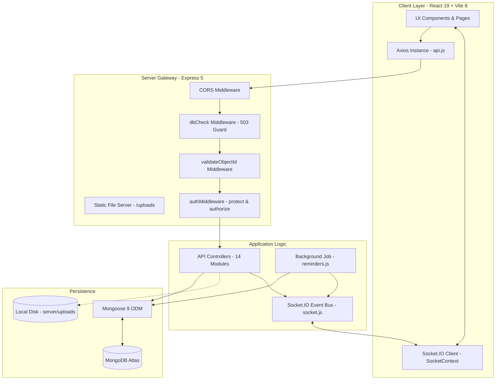
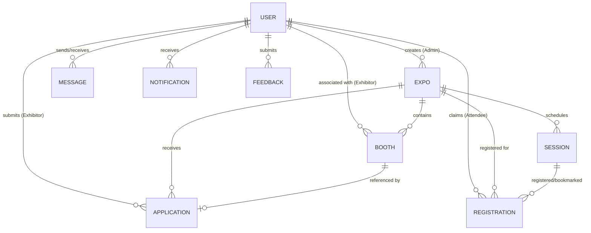
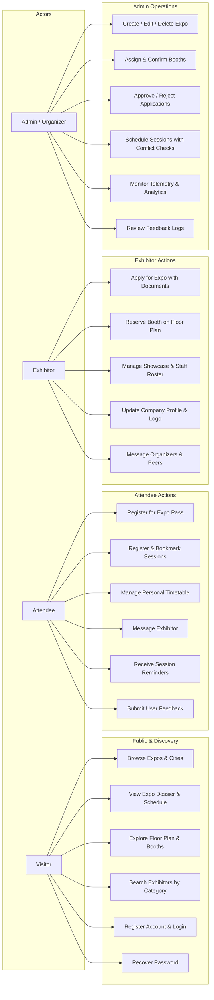

# EventSphere Management - Developer & Technical Architecture Guide

## 1. System Overview & Technology Stack

EventSphere Management is a MERN application with a React/Vite client, an Express REST API, MongoDB persistence, and Socket.IO events. The repository does not pin a Node.js or npm version, and the database may be local or hosted.

### Declared Package Versions (from package.json)

The entries below are the declared semver ranges in the client and server manifests, not a claim about the versions installed at runtime. Node.js and npm versions are not declared in those manifests.

| Component | Package Name | Declared Version | Role in Architecture |
| :--- | :--- | :--- | :--- |
| Backend Framework | express | `^5.2.1` | HTTP routing and REST endpoints |
| Database ODM | mongoose | `^9.10.3` | Schema definition, validation, and queries |
| Real-Time Server | socket.io | `^4.8.4` | WebSocket server and room dispatch |
| Authentication | jsonwebtoken | `^9.0.3` | JWT signing and verification |
| Password Hashing | bcryptjs | `^3.0.3` | Password hashing |
| File Handling | multer | `^2.4.0` | Multipart form-data parsing and local file storage |
| Security Headers | helmet | `^8.3.0` | HTTP security headers |
| Authentication Rate Limiting | express-rate-limit | `^8.7.1` | Limits selected authentication endpoints |
| CORS Management | cors | `^2.8.6` | Cross-origin request headers |
| Environment | dotenv | `^18.0.4` | Environment variable loading |
| Frontend Library | react / react-dom | `^19.2.8` | User interface components and hooks |
| Bundler & Dev Server | vite | `^8.3.0` | Frontend bundler and development server |
| Client Routing | react-router-dom | `^7.18.4` | Single-page application route management |
| HTTP Client | axios | `^1.20.0` | REST client |
| Animation | framer-motion | `^13.5.0` | Interface animations |
| Smooth Scrolling | lenis | `^1.3.26` | Scrolling behavior |
| Data Visualisation | recharts | `^3.10.1` | Charts on the analytics screen |
| Socket.IO Client | socket.io-client | `^4.8.4` | Browser Socket.IO client |

---

## 2. System Architecture & Request Lifecycle



### Request Lifecycle Flow

1. Client Dispatch: User action in a React component executes an asynchronous call through `client/src/services/api.js`.
2. Interceptor: The Axios request interceptor checks `localStorage.getItem("token")` and attaches `Authorization: Bearer <token>` if present.
3. Database Shield (`dbCheck.js`): Verifies `mongoose.connection.readyState === 1`. If disconnected, halts request immediately with HTTP 503.
4. Route Middleware: Each route applies its configured middleware in order. Selected routes use `validateObjectId.js` to reject malformed IDs with HTTP 400; protected routes use `protect` and, where required, `authorize`.
5. Authentication Guard (`authMiddleware.js` - protect): Decodes and verifies the Bearer JWT against `process.env.JWT_SECRET`. Attaches sanitized user record (`req.user`) omitting password.
6. Role Authorization (`authMiddleware.js` - authorize): Asserts `allowedRoles.includes(req.user.role)`. If unauthorized, halts with HTTP 403.
7. Controller: Executes business logic, applies route-specific ownership checks where implemented, queries Mongoose, and may emit Socket.IO events.
8. Global Error Handler (`server.js`): Handles errors propagated through Express, converts `CastError` and `ValidationError` to HTTP 400, and returns a generic message for unexpected 500 responses.

---

## 3. Real Repository Folder Structure

```
EventSphere_Eproject/
├── README.md                          # Primary project documentation and quickstart
├── package.json                       # Root workspace descriptor
├── client/                            # React frontend application
│   ├── index.html                     # HTML5 entry template
│   ├── vite.config.js                 # Vite bundler configuration
│   ├── package.json                   # Client dependency definitions
│   └── src/
│       ├── main.jsx                   # React root mount point
│       ├── App.jsx                    # Route dispatcher and layout coordinator
│       ├── index.css                  # Global styles, variables, and responsive media rules
│   ├── components/                # Shared UI, navigation, status, and landing sections
│       ├── context/
│       │   ├── AuthContext.jsx        # JWT state, user profile, login, and registration
│       │   ├── SocketContext.jsx      # Socket.IO client singleton connection
│       │   └── ToastContext.jsx       # Alert toast notifications with ARIA live region
│       ├── pages/
│       │   ├── Home.jsx               # Public landing page with attendee briefing strip
│       │   ├── Expos.jsx              # Public expo catalog with city filters
│       │   ├── ExpoDetails.jsx        # Unified expo page (Schedule, Exhibitors, Map, About)
│       │   ├── Exhibitors.jsx         # Public exhibitor directory with dynamic categories
│       │   ├── ExhibitorProfile.jsx   # Public exhibitor profile with message redirect
│       │   ├── Contact.jsx            # Public contact desk dispatching to organizer messages
│       │   ├── Feedback.jsx           # User feedback submission form
│       │   ├── Messages.jsx           # Real-time inbox, sent archive, and message composer
│       │   ├── Notifications.jsx      # Full-page system notifications log
│       │   ├── Login.jsx              # Login gateway with target resumption
│       │   ├── Register.jsx           # Registration page with role selection
│       │   ├── ForgotPassword.jsx     # Password reset token request
│       │   ├── ResetPassword.jsx      # Password reset submission
│       │   ├── Unauthorized.jsx       # 403 Forbidden error page
│       │   ├── NotFound.jsx           # 404 Route not found error page
│       │   ├── AdminDashboard.jsx     # Admin workspace launchpad
│       │   ├── ExhibitorDashboard.jsx # Exhibitor workspace launchpad
│       │   ├── admin/                 # Admin management views (Expos, Booths, Sessions, Apps, Analytics, Feedback)
│       │   ├── exhibitor/             # Exhibitor views (Profile, Expos, Applications, Booths)
│       │   └── attendee/              # Attendee views (MySchedule)
│       └── services/
│           └── api.js                 # Axios instance with auth interceptor
└── server/                            # Node.js Express backend
    ├── server.js                      # HTTP server initialization and middleware mounting
    ├── package.json                   # Server dependency definitions
    ├── .env                           # Local environment configuration
    ├── .env.example                   # Environment variable template
    ├── config/
    │   └── db.js                      # MongoDB connection loop and retry handler
    ├── controllers/                   # 14 business logic controllers
    ├── middleware/
    │   ├── authMiddleware.js          # JWT protection and role authorization
    │   ├── dbCheck.js                 # 503 database availability interceptor
    │   ├── upload.js                  # Multer disk storage and file extension filter
    │   └── validateObjectId.js        # MongoDB ObjectId parameter validator
    ├── models/                        # 9 Mongoose data schemas
    ├── routes/                        # 14 Express route modules
    ├── scripts/
    │   └── dropOldRegistrationIndexes.js # Database migration index cleanup utility
    ├── seed/
    │   ├── createAdmin.js             # Standalone admin user creation script
    │   └── seedDemoData.js            # Comprehensive deterministic demo seed engine
    ├── uploads/                       # Local file storage for logos and documents
    └── utils/
        ├── notify.js                  # Notification creation and bulk dispatch
        ├── reminders.js               # Background automated session reminder scheduler
        └── socket.js                  # Socket.IO connection and room management
```

---

## 4. Setup, Installation & Seeding Guide

### Prerequisites
- Node.js and npm versions compatible with the dependencies declared in the manifests. The repository does not specify a supported version range.
- MongoDB instance: Local MongoDB daemon (`mongodb://127.0.0.1:27017/eventsphere`) or a MongoDB Atlas connection string.

### Environment Configuration (`server/.env`)

Create `server/.env` based on `server/.env.example`:

```env
PORT=5000
MONGO_URI=your_mongodb_uri_here
JWT_SECRET=your_jwt_secret_key_here
CLIENT_URL=http://localhost:5173
DEMO_MODE=true
```

| Variable Name | Required | Default | Technical Purpose |
| :--- | :---: | :--- | :--- |
| `PORT` | Yes | `5000` | Port on which the Express HTTP and WebSocket server listens. |
| `MONGO_URI` | Yes | None | Connection string for MongoDB (local or hosted cluster); the example file contains a placeholder and the server has no fallback. |
| `JWT_SECRET` | Yes | None | Secret key used to sign and verify HMAC-SHA256 JWT tokens. |
| `CLIENT_URL` | No | `http://localhost:5173` | Configures the Express CORS origin. |
| `DEMO_MODE` | No | `true` in `server/.env.example` | Present in the example file, but not read by the current server or client code. |

Password recovery currently has no email delivery. The forgot-password controller returns a reset token and a `http://localhost:5173` reset link in its response for any known account, and also logs the link. The link is not gated by `DEMO_MODE` or `CLIENT_URL`; this is a limitation to address before production use. Reset tokens expire after 15 minutes. JWTs expire after 7 days, bcryptjs hashes passwords with cost 10, and registration/reset passwords require at least 6 characters.

### Installation Steps

1. Install backend dependencies:
   ```bash
   cd server
   npm install
   ```
2. Install frontend dependencies:
   ```bash
   cd ../client
   npm install
   ```

### Database Seeding

The project provides two seed scripts in `server/package.json`:
- `npm run seed:admin`: Creates or updates the default Super Admin user (`admin@eventsphere.com` / `Admin@123`).
- `npm run seed:demo`: Executes `server/seed/seedDemoData.js`.
  - Destructive behavior: Clears demo data (including expos, booths, applications, sessions, registrations, messages, feedback, notifications, and non-admin users) before recreating it. Do not run against data that must be retained.
  - Creation scope: Generates demo users, multiple expos and booths, sessions, applications, registrations, messages, feedback, and notifications.

### Launching the Application
- Start Backend Server (Terminal 1):
  ```bash
  cd server
  npm run dev
  ```
  Runs at http://localhost:5000.
- Start Frontend Development Server (Terminal 2):
  ```bash
  cd client
  npm run dev
  ```
  Runs at http://localhost:5173.

---

## 5. Database Schema & Data Models

### 5.1 Models and Field Specifications

#### User Model (`server/models/User.js`)

| Field | Type | Required | Default | Notes / Constraints |
| :--- | :--- | :---: | :--- | :--- |
| `name` | String | Yes | None | User's full name or representative title |
| `email` | String | Yes | None | Unique constraint; no schema-level lowercase normalization |
| `password` | String | Yes | None | Hashed with bcrypt (salt 10) in pre-save hook |
| `role` | String | Yes | `"attendee"` | Enum: `["admin", "exhibitor", "attendee"]` |
| `phone` | String | No | None | Contact telephone |
| `company` | String | No | None | Corporate brand name for exhibitors |
| `description` | String | No | None | Exhibitor company biography |
| `website` | String | No | None | Corporate URL |
| `category` | String | No | None | Industry category classification |
| `logo` | String | No | None | File path or URL to brand logo |
| `resetToken` | String | No | None | SHA-256 hashed password reset token |
| `resetTokenExpire` | Date | No | None | Token expiration timestamp (15 min) |
| `timestamps` | Date | Auto | Current time | `createdAt` and `updatedAt` |

#### Expo Model (`server/models/Expo.js`)

| Field | Type | Required | Default | Notes / Constraints |
| :--- | :--- | :---: | :--- | :--- |
| `title` | String | Yes | None | Official exhibition title |
| `description` | String | No | None | Detailed expo description |
| `theme` | String | No | None | Industry category or theme label |
| `location` | String | No | None | Venue location and address |
| `startDate` | Date | No | None | Opening date |
| `endDate` | Date | No | None | Closing date; validated >= startDate |
| `image` | String | No | `""` | Banner image URL or upload path |
| `capacity` | Number | No | `1000` | Expo registration limit |
| `createdBy` | ObjectId | No | None | Reference to User (`admin`) |

#### Booth Model (`server/models/Booth.js`)

| Field | Type | Required | Default | Notes / Constraints |
| :--- | :--- | :---: | :--- | :--- |
| `expo` | ObjectId | Yes | None | Reference to parent Expo |
| `boothNumber` | String | Yes | None | Identifier (e.g., A1, B4); unique per expo |
| `size` | String | No | None | Dimensions (e.g., 3x3 m, 6x6 m) |
| `price` | Number | No | None | Booth price; currency is not encoded in the schema |
| `status` | String | Yes | `"available"` | Enum: `["available", "reserved", "booked"]` |
| `exhibitor` | ObjectId | No | None | Reference to User (`exhibitor`) |
| `details` | String | No | None | Showcase and demo description |
| `staff` | Array | No | `[]` | Subdocuments: `[{ name: String, role: String }]` |

#### Application Model (`server/models/Application.js`)

| Field | Type | Required | Default | Notes / Constraints |
| :--- | :--- | :---: | :--- | :--- |
| `expo` | ObjectId | Yes | None | Reference to Expo applied for |
| `exhibitor` | ObjectId | Yes | None | Reference to User (`exhibitor`) |
| `companyName` | String | No | None | Legal company entity name |
| `products` | String | No | None | Showcase summary |
| `documents` | [String] | No | `[]` | File paths to uploaded paperwork |
| `status` | String | Yes | `"pending"` | Enum: `["pending", "approved", "rejected"]` |
| `booth` | ObjectId | No | None | Reference to allocated Booth |

#### Session Model (`server/models/Session.js`)

| Field | Type | Required | Default | Notes / Constraints |
| :--- | :--- | :---: | :--- | :--- |
| `expo` | ObjectId | Yes | None | Reference to parent Expo |
| `title` | String | Yes | None | Keynote or workshop title |
| `speaker` | String | No | None | Presenter name and affiliation |
| `topic` | String | No | None | Track topic name |
| `location` | String | No | None | Stage or room name |
| `startTime` | Date | No | None | Scheduled start timestamp |
| `endTime` | Date | No | None | Scheduled end timestamp; validated > start |
| `capacity` | Number | No | `100` | Seat limit checked when registering for a session |
| `reminderSent` | Boolean | No | `false` | Flag tracking automated reminder dispatch |

#### Registration Model (`server/models/Registration.js`)

| Field | Type | Required | Default | Notes / Constraints |
| :--- | :--- | :---: | :--- | :--- |
| `user` | ObjectId | Yes | None | Reference to User (`attendee`) |
| `expo` | ObjectId | Yes | None | Reference to Expo |
| `session` | ObjectId | No | None | Reference to Session (null for expo pass) |
| `type` | String | Yes | `"expo"` | Enum: `["expo", "session"]` |
| `registered` | Boolean | No | `true` | Active registration state |
| `bookmarked` | Boolean | No | `false` | Personal bookmark state |

#### Message Model (`server/models/Message.js`)

| Field | Type | Required | Default | Notes / Constraints |
| :--- | :--- | :---: | :--- | :--- |
| `sender` | ObjectId | Yes | None | Reference to User |
| `receiver` | ObjectId | Yes | None | Reference to User |
| `subject` | String | No | None | Message subject line |
| `body` | String | No | None | Message text |
| `read` | Boolean | No | `false` | Read confirmation flag |

#### Notification Model (`server/models/Notification.js`)

| Field | Type | Required | Default | Notes / Constraints |
| :--- | :--- | :---: | :--- | :--- |
| `user` | ObjectId | Yes | None | Reference to recipient User |
| `message` | String | Yes | None | Notification alert text |
| `link` | String | No | None | In-app navigation destination |
| `type` | String | No | None | Category (application, booth, reminder) |
| `read` | Boolean | No | `false` | Read status |

#### Feedback Model (`server/models/Feedback.js`)

| Field | Type | Required | Default | Notes / Constraints |
| :--- | :--- | :---: | :--- | :--- |
| `user` | ObjectId | Yes | None | Reference to submitting User |
| `type` | String | No | None | Enum: `["suggestion", "issue"]` |
| `message` | String | Yes | None | Feedback text; controller enforces a minimum length |

The nine collections are `User`, `Expo`, `Booth`, `Application`, `Session`, `Registration`, `Message`, `Notification`, and `Feedback`. There is no separate Exhibitor collection; exhibitor accounts are `User` documents with company/profile fields.

### 5.2 Database Indexes

```javascript
// User indexes:
userSchema.index({ email: 1 }, { unique: true });

// Registration indexes (Partial unique indexes enforce one registration per entity):
registrationSchema.index(
  { user: 1, expo: 1 },
  { unique: true, partialFilterExpression: { type: "expo" } }
);
registrationSchema.index(
  { user: 1, session: 1 },
  { unique: true, partialFilterExpression: { type: "session" } }
);

// Booth compound indexes:
boothSchema.index({ expo: 1, status: 1 });
boothSchema.index({ expo: 1, boothNumber: 1 }, { unique: true });

// Session compound index:
sessionSchema.index({ expo: 1, startTime: 1 });

// Message compound indexes:
messageSchema.index({ receiver: 1, read: 1 });
messageSchema.index({ sender: 1, createdAt: -1 });

// Notification index:
notificationSchema.index({ user: 1, read: 1 });

// Application compound indexes:
applicationSchema.index({ expo: 1, status: 1 });
applicationSchema.index({ exhibitor: 1, status: 1 });
```

### 5.3 Entity-Relationship (ER) Diagram



---

## 6. Use Cases

### 6.1 Role-Permission Summary

| Profile | Implemented access |
| :--- | :--- |
| Visitor (unauthenticated) | Browse public expos, expo details, booth plans and schedules, exhibitor directory/profiles, landing page, About, and Contact. Registration, login, password recovery, and reset are public. Messaging and attendee/exhibitor/admin workspaces require authentication. |
| Attendee | Visitor access plus expo and session registration, bookmarks, personal schedule, feedback submission, and messaging admins or exhibitors. |
| Exhibitor | Visitor access plus exhibitor profile/logo, expo applications, booth reservation and booth details/staff management, and messaging admins or other exhibitors through the current UI. The API also permits an attendee recipient ID, but the UI does not provide an attendee directory or general recipient picker. |
| Admin / Organizer | Manage expos, booths, applications, and sessions; view analytics and feedback; use the authenticated messages inbox and sent view. |

The use-case identifiers UC1 to UC23 below are guide-local identifiers. Their mapping to SRS use-case identifiers cannot be confirmed because the source SRS PDF was not available in the workspace.

### 6.2 Use Case Diagram



---

## 7. API Reference

All routes are mounted under `/api` in `server/server.js`.

### 7.1 Authentication (`/api/auth`)

| Method | Path | Auth Required | Roles | Purpose | Request Body | Response Payload |
| :--- | :--- | :---: | :---: | :--- | :--- | :--- |
| POST | `/register` | No | Any | Register user | `name, email, password, role, phone, company` | `201: { token, user: { id, name, email, role } }` |
| POST | `/login` | No | Any | Authenticate user | `email, password` | `200: { token, user: { id, name, email, role } }` |
| POST | `/forgot-password` | No | Any | Request reset link | `email` | `200: { message, resetToken?, resetLink? }` |
| PUT | `/reset-password/:token` | No | Any | Execute password reset | `password` | `200: { message: "Password reset successful" }` |
| GET | `/me` | Yes | Any | Get current session | None | `200: { id, name, email, role, phone, company }` |
| GET | `/admin-check` | Yes | Admin | Verify admin privileges | None | `200: { message: "Admin authorized" }` |

### 7.2 Expos (`/api/expos`)

| Method | Path | Auth Required | Roles | Purpose | Request Body | Response Payload |
| :--- | :--- | :---: | :---: | :--- | :--- | :--- |
| GET | `/` | No | Any | List all expos | None | `200: [ Expo ]` sorted by `startDate: 1` |
| POST | `/` | Yes | Admin | Create expo | `title, startDate, endDate, location, description, theme, boothCount, boothPrice, boothSize, image` (or file) | `201: Expo` |
| GET | `/:id` | No | Any | Get expo details | None | Public expo response |
| GET | `/:id/public` | No | Any | Get public expo details | None | Public expo response |
| PUT | `/:id` | Yes | Admin | Update expo | `title, description, theme, location, startDate, endDate, image` (or file) | `200: Expo` |
| DELETE | `/:id` | Yes | Admin | Delete expo | None | `200: { message: "Expo and all related booths, applications, sessions, and registrations deleted" }` |
| GET | `/:expoId/booths` | No | Any | Get booths for expo | None | `200: [ Booth ]` |
| GET | `/:expoId/sessions` | No | Any | Get sessions for expo | None | `200: [ Session ]` |

### 7.3 Booths (`/api/booths`)

| Method | Path | Auth Required | Roles | Purpose | Request Body | Response Payload |
| :--- | :--- | :---: | :---: | :--- | :--- | :--- |
| PUT | `/:id` | Yes | Admin | Edit booth specs | `size, price, details, status` | `200: Booth` |
| PUT | `/:id/assign` | Yes | Admin | Assign booth | `exhibitorId` | `200: { message, booth }` |
| PUT | `/:id/release` | Yes | Admin | Release booth | None | `200: { message, booth }` |
| PUT | `/:id/confirm` | Yes | Admin | Confirm reservation | None | `200: { message, booth }` |
| PUT | `/:id/reserve` | Yes | Exhibitor | Self-reserve booth | None | `200: { message, booth }` |
| PUT | `/:id/cancel` | Yes | Exhibitor | Cancel reservation | None | `200: { message, booth }` |
| PUT | `/:id/my-details` | Yes | Exhibitor | Update booth staff | `details, staff: [{ name, role }]` | `200: { message, booth }` |

### 7.4 Applications (`/api/applications`)

| Method | Path | Auth Required | Roles | Purpose | Request Body | Response Payload |
| :--- | :--- | :---: | :---: | :--- | :--- | :--- |
| POST | `/` | Yes | Exhibitor | Submit application | `expo, companyName, products`, multipart `documents` (max 3) | `201: Application` |
| GET | `/my` | Yes | Exhibitor | My applications | None | `200: [ Application ]` |
| GET | `/` | Yes | Admin | List applications | Query: `status, expo` | `200: [ Application ]` |
| PUT | `/:id/status` | Yes | Admin | Approve or reject | `status: "approved"` or `"rejected"` | `200: { message, application }` |

### 7.5 Sessions (`/api/sessions`)

| Method | Path | Auth Required | Roles | Purpose | Request Body | Response Payload |
| :--- | :--- | :---: | :---: | :--- | :--- | :--- |
| POST | `/` | Yes | Admin | Create session | `expo, title, speaker, topic, location, startTime, endTime` | `201: Session` |
| GET | `/:id` | No | Any | Get session | None | `200: Session` |
| PUT | `/:id` | Yes | Admin | Update session | `title, speaker, topic, location, startTime, endTime` | `200: Session` |
| DELETE | `/:id` | Yes | Admin | Delete session | None | `200: { message: "Session deleted successfully" }` |

### 7.6 Registrations (`/api/registrations`)

| Method | Path | Auth Required | Roles | Purpose | Request Body | Response Payload |
| :--- | :--- | :---: | :---: | :--- | :--- | :--- |
| POST | `/` | Yes | Attendee | Register expo pass | `expo` | `201: Registration` |
| POST | `/session` | Yes | Attendee | Register session | `session` | `201: Registration`; overlap may return a warning; full sessions are rejected |
| PUT | `/bookmark` | Yes | Attendee | Toggle bookmark | `session` | `200: Registration` or `200: { message: "Bookmark removed" }` |
| GET | `/my` | Yes | Attendee | List my timetable | None | `200: [ Registration ]` |
| DELETE | `/:id` | Yes | Attendee | Cancel registration | None | `200: { message }` |

### 7.7 Messages (`/api/messages`)

| Method | Path | Auth Required | Roles | Purpose | Request Body | Response Payload |
| :--- | :--- | :---: | :---: | :--- | :--- | :--- |
| POST | `/` | Yes | Any (Matrix) | Send message | `receiver, subject, body` | `201: Message` |
| GET | `/inbox` | Yes | Any | Get inbox | None | `200: [ Message ]` |
| GET | `/sent` | Yes | Any | Get sent messages | None | `200: [ Message ]` |
| PUT | `/:id/read` | Yes | Any | Mark read | None | `200: { message, messageObj }` |
| GET | `/unread-count` | Yes | Any | Unread count | None | `200: { count: Number }` |
| GET | `/admin-contact` | Yes | Any | Get admin recipient | None | `200: { _id, name }` |

### 7.8 Public Endpoints (`/api/public`)

| Method | Path | Auth Required | Roles | Purpose | Request Parameters | Response Payload |
| :--- | :--- | :---: | :---: | :--- | :--- | :--- |
| GET | `/landing-data` | No | Any | Home data package | None | `200: { stats, allExpos, featuredExpo, sessions, booths, approvedExhibitors }` |
| GET | `/stats` | No | Any | Platform counters | None | `200: { totalExpos, totalExhibitors, totalSessions, totalAttendees, totalBooths, bookedBooths, occupancyRate }` |
| GET | `/expos` | No | Any | All expos | None | `200: [ Expo ]` |
| GET | `/expos/:id` | No | Any | Public expo dossier | Param: `id` | `200: { expo, sessions, booths, exhibitors }` |
| GET | `/exhibitors` | No | Any | Exhibitor directory | Query: `search, category` | `200: [ Exhibitor ]` |
| GET | `/exhibitors/:id` | No | Any | Exhibitor profile | Param: `id` | `200: { _id, name, company, description, website, category, logo, products, expos }` |
| GET | `/featured-exhibitors` | No | Any | Top partners | None | `200: [ Exhibitor ]` |

### 7.9 Other Endpoints
- Profile (`/api/profile`): `GET /` (get profile), `PUT /` (update profile), `POST /logo` (upload logo).
- Users (`/api/users`): `GET /` (admin only, filter by role).
- Exhibitors (`/api/exhibitors`): `GET /` (logged-in list), `GET /categories`, `GET /:id`.
- Feedback (`/api/feedback`): `POST /` (submit feedback), `GET /` (admin review).
- Notifications (`/api/notifications`): `GET /` (history), `GET /unread-count`, `PUT /read-all`, `PUT /:id/read`.
- Analytics (`/api/analytics`): `GET /admin` and `GET /` (admin executive dashboard; both routes use the same handler).
- Infrastructure: `GET /api/health` (health check returning `{ status, database }`).

---

## 8. Real-Time WebSocket Architecture

Socket.IO is mounted on the primary Node HTTP server in `server/utils/socket.js`.

### Authentication Handshake

Clients connect with an authorization payload:
```javascript
const socket = io("http://localhost:5000", { auth: { token } });
```
The server verifies the JWT token. Upon connection:
- User Room: Automatically joins `user:<userId>`.
- Role Room: Automatically joins `role:<userRole>`.

### Socket Events Reference

| Event Name | Direction | Emitter | Listener Component(s) | Payload | Functional Purpose |
| :--- | :--- | :--- | :--- | :--- | :--- |
| `booth:updated` | Server -> Client | `boothController.js` | `ExpoDetails.jsx`, `AdminBooths.jsx`, `ExhibitorBooths.jsx` | `{ expoId }` | Re-fetches floor plan layout instantly when a booth is reserved, assigned, or released. |
| `schedule:updated` | Server -> Client | `sessionController.js` | `ExpoDetails.jsx`, `AdminSessions.jsx`, `MySchedule.jsx` | `{ expoId }` | Re-fetches conference timetables when sessions are added, edited, or deleted. |
| `expo:updated` | Server -> Client | `expoController.js` | No client listener identified | `{ expoId, action }` | Emitted when an expo is created, updated, or deleted; current client pages do not subscribe to it. |
| `message:new` | Server -> Client | `messageController.js` | `Navbar.jsx`, `Navigation.tsx` | `Message` | Updates the navigation unread-message badge for the recipient. |
| `notification` | Server -> Client | `notify.js` | `NotificationBell.jsx`, `ToastContext.jsx` | `Notification` | Triggers alert toast notification and increments notification bell badge. |

The notification event is named `notification` (not `notification:new`).

---

## 9. Background Jobs & Scheduled Workers

### Session Reminder Scheduler (`server/utils/reminders.js`)

- Initialization: Triggered once after MongoDB connects via `startReminders()` in `server/server.js`.
- Execution Interval: Runs every 60,000 ms (60 seconds).
- Algorithm:
  1. Computes the target window: `now` to `now + 30 minutes`.
  2. Queries `Session.find({ startTime: { $gte: now, $lte: thirtyMinsLater }, reminderSent: false })`.
  3. For each upcoming session, queries `Registration.find({ session: session._id, $or: [{ registered: true }, { bookmarked: true }] })` to identify both registered and bookmarked attendees.
  4. Dispatches an in-app notification via `notifyMany(userIds, message, link)`.
  5. Sets `session.reminderSent = true` and saves the document to prevent duplicate alerts.
  6. If an administrator edits a session's start time in `sessionController.js`, `reminderSent` resets to `false`.

---

## 10. File Upload Specifications

File uploads are managed by Multer in `server/middleware/upload.js`.

- Destination: Files are stored on local disk in `server/uploads/`.
- Static Serving: Exposed at `http://localhost:5000/uploads/*` via `app.use("/uploads", express.static(path.resolve("uploads")))` in `server/server.js`.
- Size Ceiling: 5 MB (`limits: { fileSize: 5 * 1024 * 1024 }`).
- File Naming: Stored names include a timestamp and random numeric suffix: `${Date.now()}-${Math.round(Math.random() * 1e9)}${ext}`.
- Extension Whitelist:
  - Image uploads: `.jpeg`, `.jpg`, `.png`, `.webp`; uploads on the `image` field also require an image MIME type.
  - Other upload fields: `.jpeg`, `.jpg`, `.png`, `.webp`, `.pdf`, `.doc`, `.docx`. These fields are filtered by file extension.
  - Executable extensions (`.exe`, `.sh`, `.php`, `.js`, `.html`) are rejected with an error.

---

## 11. Security Implementation Review

1. Password Cryptography: Salted hashing via `bcryptjs` with cost factor 10 in Mongoose pre-save middleware. Raw passwords are never stored or logged.
2. Token Security: Signed 7-day JWTs. `JWT_SECRET` must be configured for successful token verification; the application does not explicitly terminate at startup when it is absent.
3. Ownership and Role Checks: User-scoped handlers and admin/exhibitor routes include ownership and role checks. Review each state-changing controller and route before deployment; do not infer universal coverage from this summary.
4. Role Matrix Enforcement: Server-side messaging restrictions prevent attendees from messaging other attendees; only organizers and exhibitors are valid recipients.
5. ObjectId Validation: Routes that attach `validateObjectId.js` reject malformed route parameters named `id` or ending in `Id` with HTTP 400. The middleware is not applied to every route.
6. Public Output Scrubbing: Public expo and exhibitor endpoints strip user email addresses, phone numbers, and password reset tokens.
7. Reset Token Protection: Reset tokens are generated via `crypto.randomBytes(20)` and stored as SHA-256 hashes in MongoDB. The current forgot-password response and server log disclose the plaintext reset link without checking `DEMO_MODE`; email delivery is not implemented.
8. ReDoS Protection: Search inputs in `exhibitorController.js` are escaped with `replace(/[.*+?^${}()|[\]\\]/g, "\\$&")` before regular expression compilation.

---

## 12. Non-Functional Requirements Compliance Matrix

| Metric | Brief Requirement | Implementation Status | Implementation Evidence & Technical Notes |
| :--- | :--- | :---: | :--- |
| Security | Password hashing, authentication, and role control | Partially Implemented | Bcrypt cost 10, JWT, route role checks, selected ObjectId validation, and sanitized public projections are present. Encryption at rest, TLS configuration, and comprehensive control coverage have not been verified. |
| Performance | 1 to 2 second response times | To be verified | Some compound indexes are defined. No response-time benchmark is documented; performance targets have not been verified. |
| Availability | 99% uptime target, health checks | Partially Implemented | `/api/health` endpoint and MongoDB reconnection handling with a 503 database guard are implemented. No uptime or backup evidence is available. |
| Usability | Intuitive UI, responsive design | Implemented | High-contrast Neo-Brutalist design system, fluid `clamp()` fonts, mobile navigation drawers, and active route indicators. |
| Accessibility | Accessibility and assistive technology support | Partially Implemented | Some focus styling and ARIA live regions are present. Contrast, keyboard flow, screen-reader behavior, and WCAG conformance have not been verified. |
| Compatibility | Cross-browser & responsive behavior | To be verified | Responsive styling is present. Chrome, Firefox, Edge, and Safari testing has not been evidenced. |
| Scalability | Horizontal scaling capability | Partially Implemented | Stateless JWT auth; local uploads and single-process WebSocket bus would require S3 and Redis pub/sub for multi-instance scaling. |
| Monitoring | Logging and monitoring tools | Partially Implemented | Console logging and server-side stack trace capture; structured cloud logging (e.g., Winston, Pino) is not integrated. |
| Testing | Unit, integration, and E2E coverage | Not Executed | Playwright E2E configuration and test files exist, and manual test specifications are in `docs/TEST_CASES.md`. Results are not asserted here. |
| Documentation | User, developer, and video guides | Partially Implemented | Markdown guides and test specifications are present. The requested source SRS PDF and original Word document were not present, so the Word deliverable and SRS traceability remain incomplete. |
| Privacy | NFR-PRV-01/02: GDPR and consent | Not implemented | No consent capture, privacy route/policy, data export, or account deletion flow was identified. |
| Concurrent-user load testing | SRS load requirement | Not Executed | No concurrent-user load-test results are available. |
| Penetration testing | SRS security verification | Not Executed | No penetration-test results are available. |

Authentication rate limiting is implemented for `/api/auth/login`, `/api/auth/register`, and `/api/auth/forgot-password`: 20 requests per IP per 15 minutes in `server/server.js`. This documents the control, not test evidence.

The analytics controller does not calculate booth-traffic or session-popularity metrics (SRS FR-ANA-01). Attendance categories are estimated using hard-coded proportions, and booth chart values use hard-coded fallback values when counts are zero; these chart values are not fully measured analytics.

---

## 13. Known Limitations and Future Scope

### Known Limitations
1. In-App Only Reminders: The reminder worker dispatches in-app notifications and WebSocket alerts. Email delivery via SMTP (SendGrid, Mailgun, Nodemailer) is not implemented.
2. Local Disk Storage: Uploaded exhibitor documents and logos are stored in `server/uploads/` on the local file system rather than Amazon S3 or Cloudinary.
3. No Automated Test Runner: There are no unit or integration test runners (Vitest, Jest) configured in `package.json`.
4. Simulated Analytics: Attendance categories and some booth chart values in `analyticsController.js` use hard-coded proportional/fallback values. Booth traffic and session popularity are not measured.
5. In-Memory Socket Adapter: Sockets run in a single Node process without a Redis pub/sub adapter.

### Future Scope
1. Integration of Nodemailer / SendGrid for production email notifications and password reset delivery.
2. Migration of file storage to Amazon S3 or Cloudinary with pre-signed upload URLs.
3. Implementation of Redis adapter for multi-instance horizontal scaling.
4. Exporting session schedules directly to Google Calendar and Apple iCal (.ics format).
5. Stripe or PayPal payment gateway integration for commercial booth leasing.

---

## 14. Troubleshooting Runbook

### MongoDB Connection Outages
- Symptom: Server returns HTTP 503 Service Unavailable with message "The database is unavailable. Please try again shortly."
- Resolution: Check that your MongoDB Atlas IP Access List includes your current public IP address (or `0.0.0.0/0` for development). If using local MongoDB, verify that the local service is running (`sudo systemctl status mongod` or Windows Services). The server automatically attempts reconnection every 10 seconds.

### Duplicate Key Errors (E11000)
- Symptom: Console logs report `E11000 duplicate key error collection: eventsphere.registrations`.
- Resolution: Run the index migration utility:
  ```bash
  cd server
  node scripts/dropOldRegistrationIndexes.js
  ```
  This removes outdated unique indexes from previous schema iterations and applies partial compound unique indexes.

### Port Conflicts
- Symptom: `Error: listen EADDRINUSE: address already in use :::5000`.
- Resolution: Kill the process holding port 5000:
  - Windows: `netstat -ano | findstr :5000` followed by `taskkill /PID <PID> /F`.
  - macOS/Linux: `lsof -i :5000` followed by `kill -9 <PID>`.

### Environment Variable Reloading
- Symptom: Changes to `server/.env` are not reflected in application behavior.
- Resolution: Nodemon does not always detect changes to non-JavaScript files. Stop the server (Ctrl + C) and restart with `npm run dev`.
